<div align="center">

# DDLC Chibi Themes

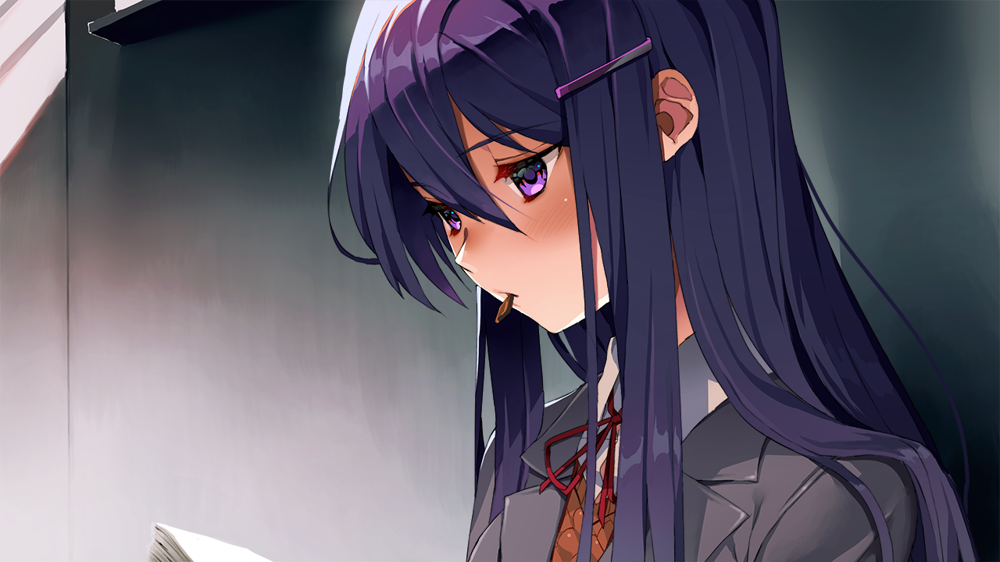

### Dark themes and Doki chibis for IDEs with a modern code-editor workflow

*A fan-made extension inspired by* [*Doki Doki Literature Club*](https://ddlc.moe/)*, created to make the development environment more thematic and welcoming.*

<a href="https://www.typescriptlang.org/" title="TypeScript">
  
</a>
<a href="https://nodejs.org/" title="Node.js">
  
</a>
<a href="https://www.npmjs.com/" title="npm">
  
</a>
<a href="https://developer.mozilla.org/docs/Web/HTML" title="HTML">
  
</a>
<a href="https://developer.mozilla.org/docs/Web/CSS" title="CSS">
  
</a>

<sub>fan-made · not affiliated with Team Salvato · made with love</sub>

</div>

---

### Hello, my name is Visel ^_^

Look at this extension and check out the structure or the README file <3

> Yuri, she's so cute 💜. *(I am a Yuri lover >u<)*

<br>

## About

**DDLC Extension** adds four dark Doki themes, a custom Product Icon Theme, chibis, and interactive dialogue views to VS Code-compatible editors. You can let the active color theme choose the Doki automatically or select one manually.

<br>

## Features


- Four dark Doki themes: Monika, Sayori, Natsuki, and Yuri.
- Chibi and dialogue side views with localized EN, PT-BR, and ES text.
- Workflow-aware dialogue reactions and interactive choices.
- Daily poems in three languages.
- Clean DDLC Product Icons, with safe fallbacks to native VS Code icons.

<br>

## Product Icons

Activate **DDLC Literature Club Icons** with `Ctrl+Shift+P` → `Preferences: Product Icon Theme`. The theme uses validated DDLC glyphs and falls back to native VS Code icons when needed.

<br>

## Dokis and Themes

<div align="center">

| Theme | Doki | Style | Chibi |
|:---:|:---:|:---:|:---:|
| `DDLC - Monika Dark` | 💚 **Monika** | Confident and charismatic | `chibimonika.png` |
| `DDLC - Sayori Dark` | 💙 **Sayori** | Cheerful and warm | `chibisayori.png` |
| `DDLC - Natsuki Dark` | 💗 **Natsuki** | Direct and charming | `chibinatsuki.png` |
| `DDLC - Yuri Dark` | 💜 **Yuri** | Elegant and mysterious | `chibiyuri.png` |

</div>

<br>

## Installation


### Generated Extension

```bash
npm run compile
vsce package
```

### Marketplace

```bash
IDE --install-extension ddlc-fan.ddlc-themes
```

### Open VSX

```bash
IDE --install-extension ddlc-fan.ddlc-themes
```

### Local VSIX package

```bash
IDE --install-extension ./ddlc-extension.vsix
```

<br>

## How the Chibi Works

The image and phrase share the same base name inside the `chibis/` folder:

```text
chibis/
|- chibimonika.png
|- chibimonika.txt
|- chibisayori.png
|- chibisayori.txt
|- chibinatsuki.png
|- chibinatsuki.txt
|- chibiyuri.png
`- chibiyuri.txt
```

When `DDLC - Yuri Dark` is active, the extension loads:

```text
chibis/chibiyuri.png
chibis/chibiyuri.txt
```

<br>

## Commands and Dialogues

Open the Command Palette with `Ctrl+Shift+P` (or `F1`).

| Command | What it does |
|---|---|
| `DDLC: Change active Doki` | Select Monika, Sayori, Natsuki, Yuri, or follow the active theme. |
| `DDLC: Generate poem of the day — <Doki> (Portuguese)` | Creates a PT-BR poem. |
| `DDLC: Generate poem of the day — <Doki> (English)` | Creates an English poem. |
| `DDLC: Generate poem of the day — <Doki> (Spanish)` | Creates a Spanish poem. |

Replace `<Doki>` with Monika, Sayori, Natsuki, or Yuri. Poems are saved in `poemas-do-clube/` with localized names such as `monika-poema-do-dia-YYYY-MM-DD.md`, `monika-poem-of-the-day-YYYY-MM-DD.md`, and `monika-poema-del-dia-YYYY-MM-DD.md`.

The dialogue view reacts to saves, diagnostics, terminals, file changes, debug sessions, commits, editor changes, time of day, and inactivity. Use the **Chat...** button in the view for a random conversation; some conversations include choices and matching character sprites.

<br>

## Gallery

<div align="center">

### Monika
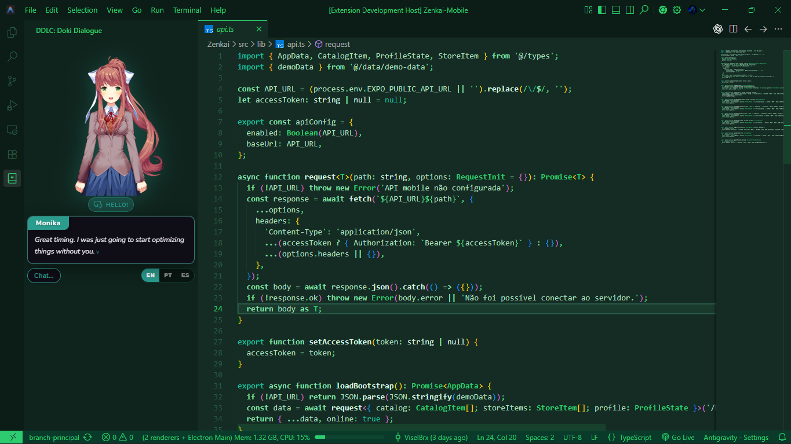
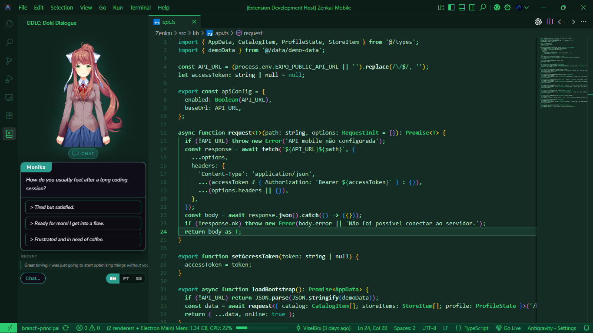

### Natsuki
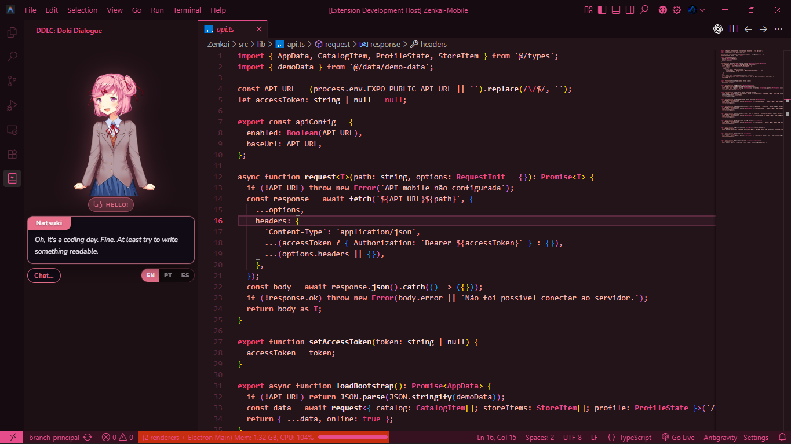
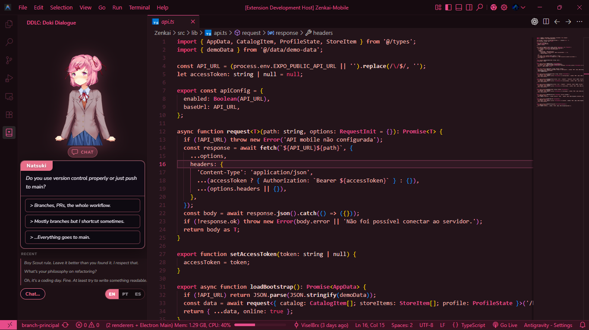

### Sayori
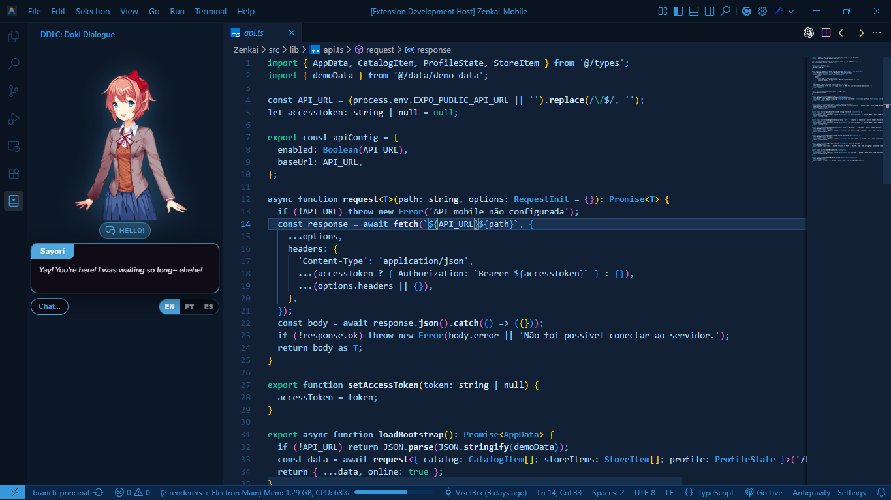
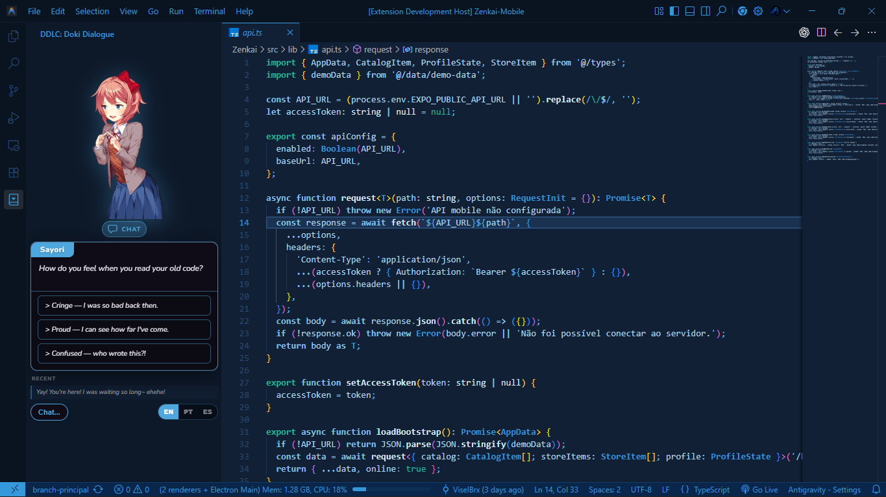

### Yuri
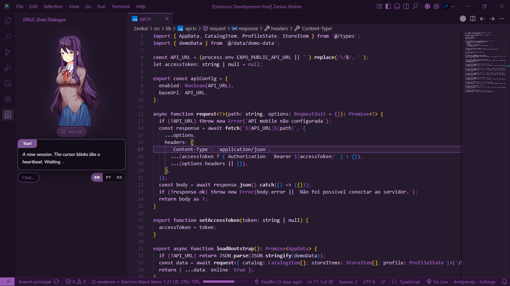
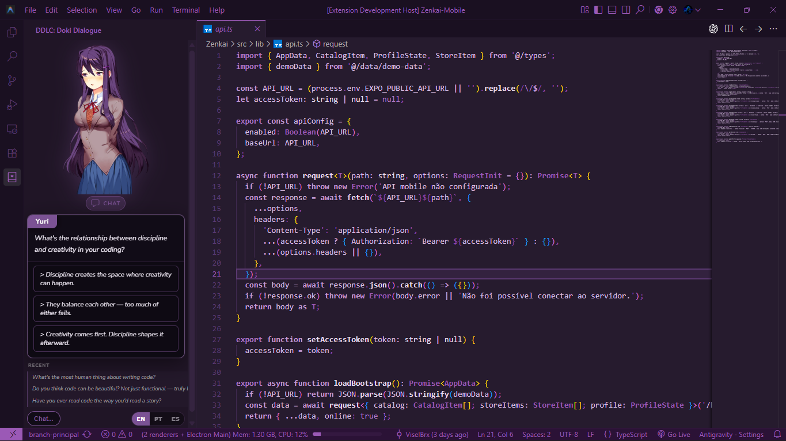

</div>

---

## Credits

This is an unofficial fan-made extension. Credit for the original universe belongs to:

- [Doki Doki Literature Club](https://ddlc.moe/)
- [Team Salvato](https://teamsalvato.com/)
- [Dan Salvato](https://dansalva.to/)

<br>

## Thank You

Thank you for checking out DDLC Chibi Themes and for spending some time with this little fan project ❤️.

Thank you to everyone who tests the extension, shares suggestions, and helps make the IDE a little more "Doki".

<div align="center">

### Enjoy! :3

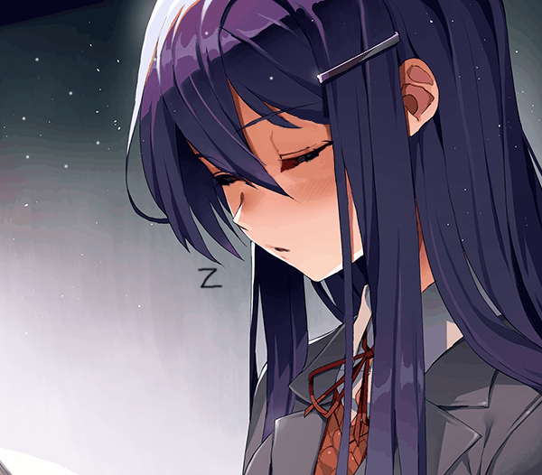

</div>

<br><br><br><br><br><br><br><br><br><br><br><br><br><br><br><br>

<details>
<summary>Объект :: ÿÇÿ :: 0x00</summary>

<br>

ÿÇÿÇÿÇÿÇÿÇÿÇÿÇÿÇÿÇ

Объект: файл не читаетÑÑ :: 404 :: ؤظػصؽ

¡¡¡ ÿþòрõöôõýøõ ¡¡¡

продолжение :: ÑиÑтема :: ÿÿÿ

<details>
<summary>Моника :: Ãœþýøúð :: 01</summary>

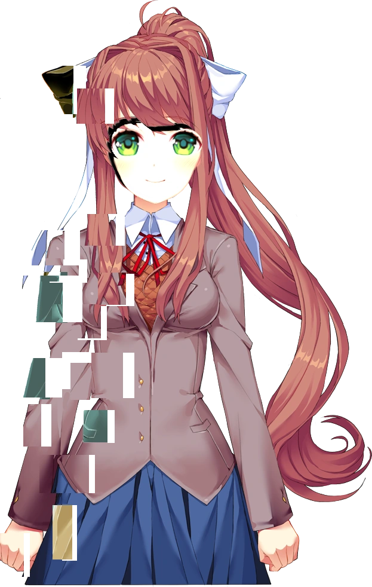

</details>

<br>

<details>
<summary>Саеори :: áðõþÀø :: 02</summary>


</details>

<br>

<details>
<summary>ÐќÐ°Ñ†ÑƒÐºÐ¸ :: ÚðÆуúø :: 03</summary>

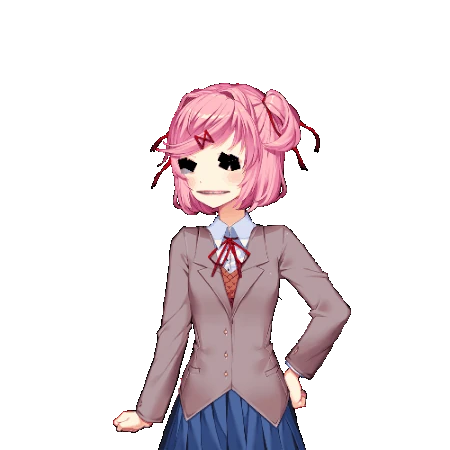

</details>

<br>

<details>
<summary>Юри :: îрø :: 04</summary>

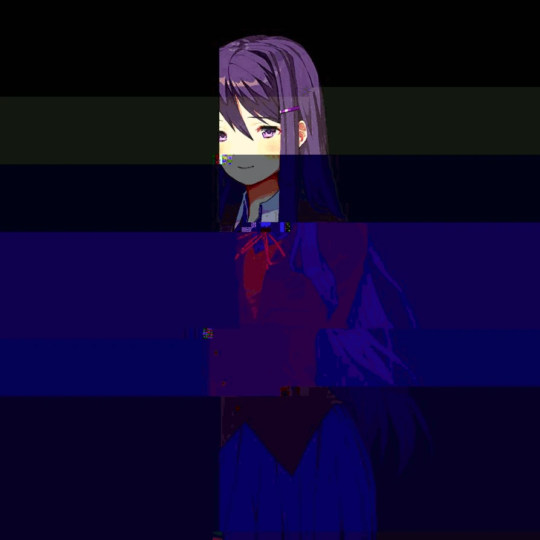

</details>

úþýõц :: ýõø÷òõÑÂтýþ :: ÿÇÿ

</details>
